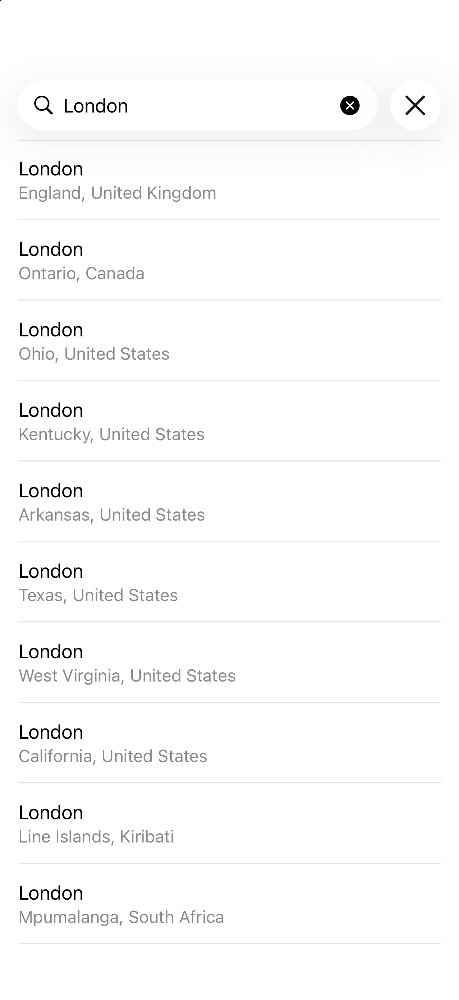
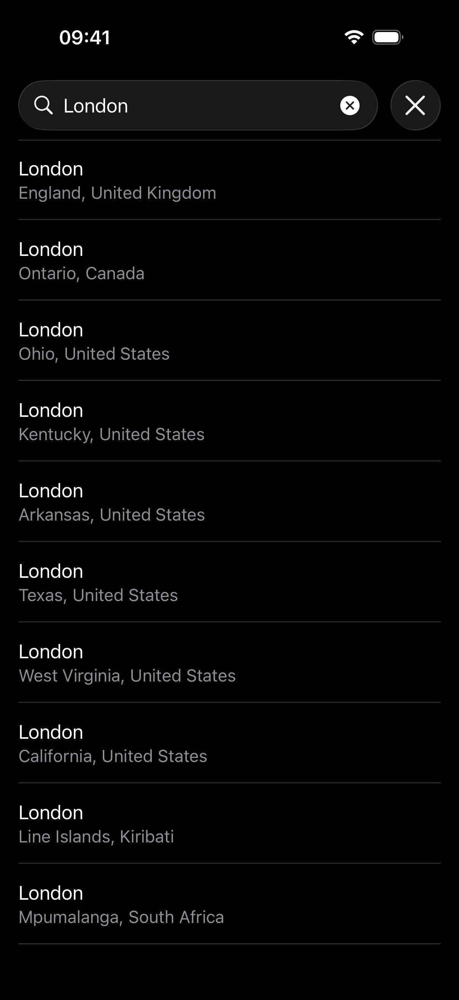
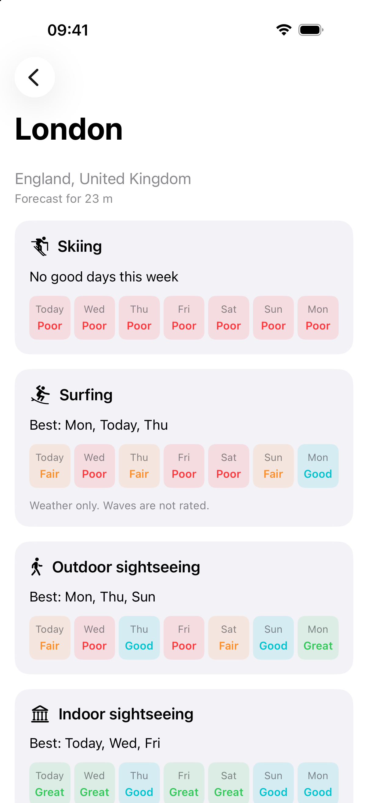
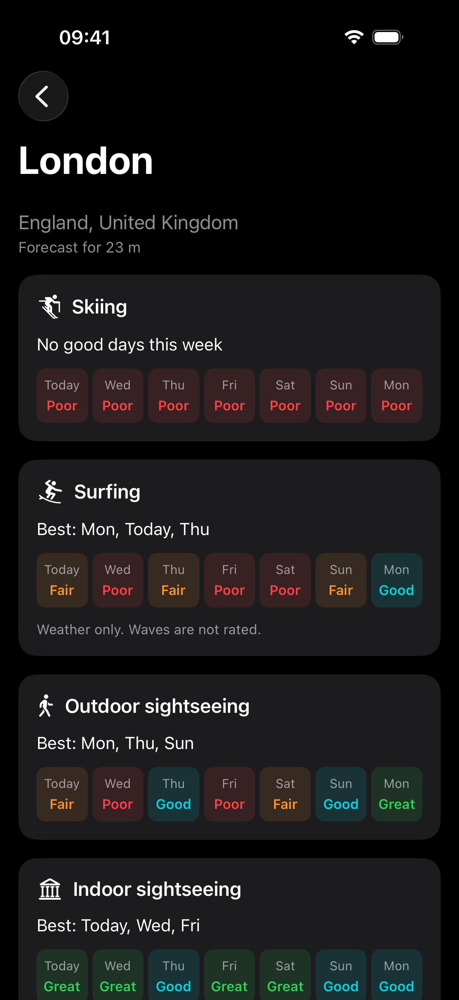
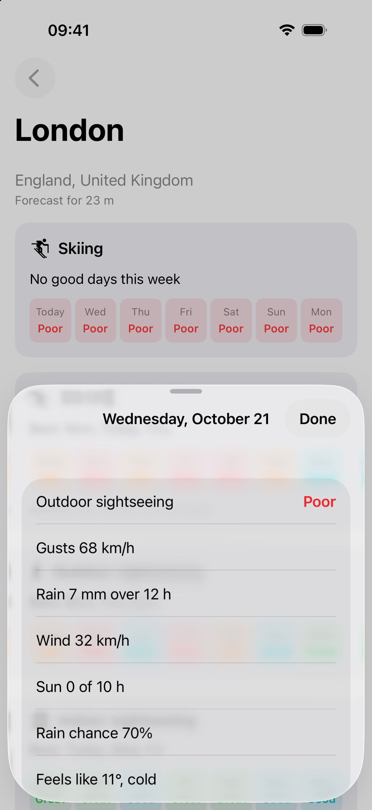
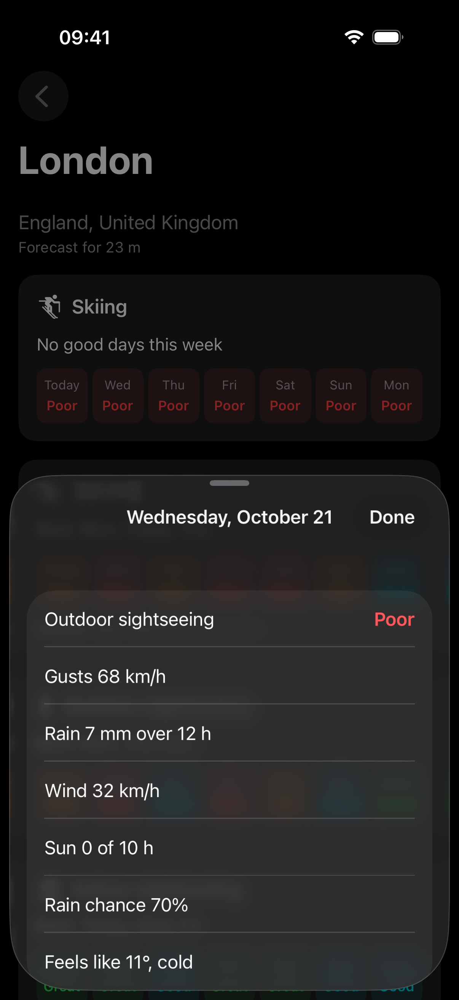
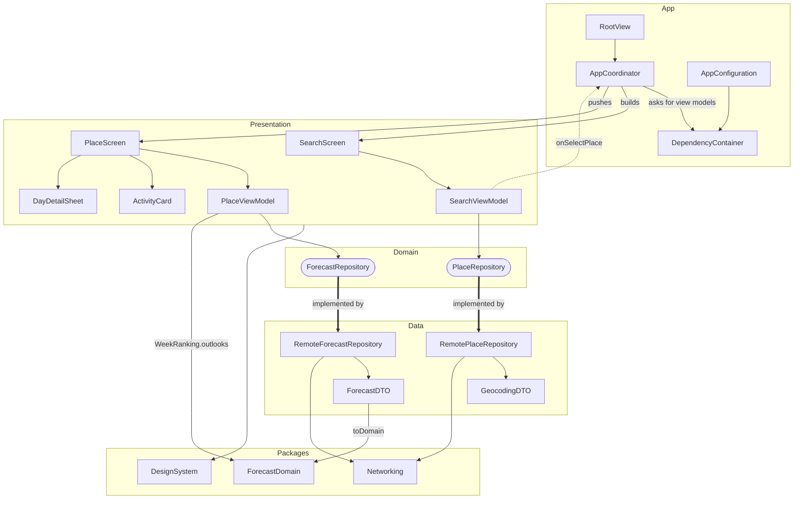

# Outdoor

Search for a city or town and see how suitable each of the next 7 days is for skiing, surfing, outdoor
sightseeing and indoor sightseeing. SwiftUI, iOS 17+, iPhone only, Swift 6. Weather from
[Open-Meteo](https://open-meteo.com/) (Geocoding and Forecast APIs).

## Features

- **Search as you type.** Debounced at 300 ms. A stale response never replaces a newer one, and only
  cities and towns are shown, with region and country on every row.
- **One card per activity** (skiing, surfing, outdoor, indoor), each with its best days and a 7-day strip
  rated **Great, Good, Fair, Poor** or **No data**.
- **Tap a day** to see why it got its rating ("Gusts 68 km/h") and the forecast values behind it.
- **The place's own days**, from its time zone, starting with "Today".
- **Loading, empty, offline and error states**, with Retry. An HTTP 503 is retried once, silently.
- **Light and Dark Mode.** A rating is always a word as well as a colour.

A day's rating is the worst cap from its factors (rain, wind, gusts, temperature, sunshine, snow depth,
storms), and the capping factors become the reasons. Indoor is outdoor reversed. All thresholds live in
[Thresholds.swift](Packages/ForecastDomain/Sources/ForecastDomain/Thresholds.swift).

## Screenshots

| | Light | Dark |
|---|---|---|
| Search |  |  |
| Place |  |  |
| Day detail |  |  |

## Running

Requires Xcode 26 or later. Open `Outdoor.xcodeproj`, pick the `Outdoor` scheme and an iPhone simulator,
and run. No API key and no third-party dependencies; the three local packages resolve automatically.

App tests (⌘U in Xcode):

```bash
xcodebuild test -project Outdoor.xcodeproj -scheme Outdoor -destination 'platform=iOS Simulator,name=iPhone 17 Pro'
```

Package tests run on the Mac:

```bash
swift test --package-path Packages/ForecastDomain
```

```bash
swift test --package-path Packages/Networking
```

## Design

Clean Architecture with MVVM and a Coordinator, organised by feature. Domain depends on nothing; Data and
Presentation both depend on Domain.



- **ForecastDomain**: forecast models, activity rules, thresholds and week ranking. Pure Swift.
- **Networking**: a typed-error `NetworkClient` over `URLSession`, plus a decorator that retries HTTP 503.
- **DesignSystem**: semantic colours, text styles, spacing and SF Symbol tokens.
- Each `@Observable` view model owns one `State` enum and maps Domain into view data, so views never see
  a Domain type.
- Swift 6 language mode with complete strict concurrency; only the UI layer is `@MainActor`.

## Trade-offs

- **No wave data, so surfing is rated on weather only.** Wave height, period and swell need the
  [Open-Meteo Marine API](https://open-meteo.com/en/docs/marine-weather-api), which should be added next.
  Until then the surfing card says "Weather only. Waves are not rated." The surfing rules are isolated, so
  waves can be added without touching the other activities.
- **Ratings use weather only.** The app doesn't know whether a place has a coast, slopes or museums, so it
  will rate surfing in Zurich.
- **Skiing uses the forecast at the town's height.** Zermatt (1,608 m) can read "No snow" while its
  slopes have snow. The height is shown on screen so the rating explains itself.

## Out of scope

- Persistence (recents, favourites, offline cache)
- Dynamic Type
- Accessibility
- Internationalisation (English only, metric units)

Weather data by [Open-Meteo.com](https://open-meteo.com/) (CC BY 4.0).
